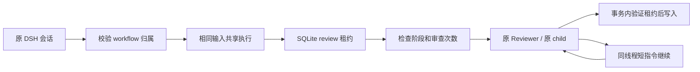

# 2026-10-05：审查准入、超时预算与等待句柄清理

接续[宿主恢复与用量记录](2026-10-05-host-recovery-and-usage.md)。本轮采用[已核验的 GitHub 用量与预算机制](../research/github-usage-budget-patterns-2026-10-05.md)，先修正会重复执行模型或掩盖消耗的真实边界，再考虑持久用量账本。

## 证据、问题与实施

| 已复现问题 | 实施与验证边界 |
|---|---|
| 两个相同审查请求同时通过相位检查，创建两个 Reviewer；`maxReviewCycles: 1` 最终累计两轮 | 同 workflow/input 共享执行，不同输入拒绝；SQLite workflow 租约覆盖多 Manager；准入内重查阶段、计划与次数限制 |
| 原租约失效后，旧模型结果仍可能写入结果或恢复状态 | `WorkflowReviewAdmission` 在 `store.update` 的 SQLite 事务内检查 owner、epoch 与有效期；失效时拒绝写入和后续模型准入 |
| `reviewOnly` 的前置模型解析尚未返回时，stop 已结束，随后新增工作流记录 | 全入口纳入 foreground 等待并融合生命周期信号；解析后与保存前再次检查停止 |
| 等待中的 Reviewer 保持 `executing`/`fixing`，真实 Token 通知被相位门禁隐藏 | 从已授权的原等待句柄判断阶段，不根据 `reviewing` 一种相位推测原线程 |
| Bridge 回调持有原 Reviewer，但 Manager 状态没有这个句柄 | dispatcher 提供只读原线程用量观察；运行、计划重试期间使用被 claim 的原 Reviewer，清理或进程丢失后撤销 |
| 原 App Server 真实错误 `Codex turn timed out: <turnId>` 未被统一分类器识别 | 精确识别模型等待超时；第一次短指令继续，第二次保留等待，原线程和原生 child 不变；控制 RPC 超时不混入长重试或模型恢复 |
| 合法 Planner 路径耗时 30 分钟，原工具期限只有 24 分 25 秒 | 每个可能的串行模型/控制操作各预留 retry budget，乘法溢出饱和，避免遗漏预算 |
| CLI 归一和对齐按另一项 `callbackTimeoutMs` 等待，原 Reviewer 工具期限漏算 | 最多六个实际 CLI 子进程回合独立预留时间和重试预算；先失败的 App Server 回合与随后 CLI 回退叠加计算 |
| 取消等待中的 Planner/Reviewer 后原 App Server 订阅仍加载 | 同步取得清理所有权，等待原 subscription/child/pin 清理；并发取消或停止只清理一次，stop 等待已开始的异步清理 |

## 模块与准入关系



`WorkflowReviewAdmission` 集中封装异步作用域与存储写入守卫，前台审查派生的进度、等待和结果写入都受同一租约约束。公开 cancel/status/stop 及其他工作流保持自身权限。检查发生在 mutation 事务内，而不是在异步模型请求前仅检查一次。即使测试 gateway 忽略 abort 返回旧结果，旧执行者仍不能改写记录或释放后继者的租约。

同输入包含实施摘要、文件列表与测试结果的固定副本；共享只发生在同一 Manager 的同一个 workflow。跨 Manager 争用明确拒绝，独立 workflow 仍可并行。原等待 Reviewer 转入既有 resume，不创建新 review/start；真正的 `reviewOnly` 新任务仍创建新 workflow。

## 超时预算口径

令 `T=turnTimeoutMs`、`R=rpcTimeoutMs`、`B=transientRetryBudgetMs`、`C=callbackTimeoutMs`：

- Planner 上界为 `5T + 40R + 45B + cleanup margin`。
- Reviewer 上界为 `8T + 40R + 6C + 54B + persisted-readback windows + cleanup margin`。
- 六个 CLI 回合来自四次归一/对齐，以及 CLI 和解中的可见审查与可能的展示修正。
- 原三个参数的 `reviewToolTimeout` 辅助函数保持兼容；实际工具注册传入 `C`。

这是宿主允许操作完成的保守期限，不增加实际模型重试、自动 continuation 或审查轮数。明确上游暂时故障仍使用原有 backoff；本地模型回合超时只进入一次自动 continuation。虚拟时钟回归模拟耗时，没有请求真实模型或等待数十分钟。

## 用量与资源验收

新增真实 stdio 协议边界测试，使用实际 App Server client、WorkflowManager、SQLite Store 和 callback dispatcher。覆盖 Planner/Reviewer/fixing 等待、Bridge 等待、私有 fork 不冒充原线程、未启动模型的准入观察，以及原线程取消清理。

测试样本中的原 Reviewer 为 120 tokens、私有 fork 为 1200 tokens，状态只返回原 Reviewer；这些是协议样本，不是用户模型消耗。用量仍是 `current_original_thread` 的服务器累计快照，清理后不持久保留，也不能当成全工作流账单。独立持久账本与可选 Token 上限列在研究建议中，尚未实施。

等待资源清理先从运行表取走句柄，再异步处理；子会话 finish/dispose 报错也不能跳过 unsubscribe 和 pin 释放。真实 RPC 回归验证只解除一次原 source 订阅、无关线程保持加载、stop 等待并发取消的清理。

## 验证入口

```powershell
pnpm exec tsx --test test/review-admission.test.ts test/workflow-usage-boundary.test.ts
pnpm exec tsx --test test/operation-budget.test.ts test/model-timeout-recovery.test.ts
pnpm verify
pnpm release:check
pnpm release:check
pnpm host:check
pnpm host:recovery:check
git diff --check
```

所有测试采用隔离存储、本地故障注入与本地子进程。正式 DSH 界面与真实模型验收仍未完成；本轮没有重启正式 DSH、发布、推送或修改用户配置。

## 最终门禁结果

| 检查 | 本轮实测 |
|---|---|
| `pnpm verify` | 类型与构建通过；562/562 tests，失败 0，43.58 秒 |
| `pnpm release:check` | 连续两次 `RELEASE_CHECK_OK`；全套测试各 562/562；离线 Doctor 正常，5 项明确 SKIPPED；打包审计通过、临时包清理 |
| `pnpm host:check` | DSH 0.1.7-rc.2；9 工具注册/卸载通过，peer 与原生 sidebar 契约通过 |
| `pnpm host:recovery:check` | 四场景通过；线程与 child 均只创建一次，续跑三个原生回合，未完成工具为 0 |
| `git diff --check` | 通过 |

本轮增加 39 个回归。其中审查准入 15 项、真实用量及等待清理边界 12 项、真实模型超时分类 2 项与 Manager 超时恢复 4 项，其余为操作预算及超时算术。源码研究核验了 21 个固定提交源码链接，没有复制第三方代码或增加依赖。

日志位于系统 Temp：`dsh-fourth-final-verify-20261005.log`、`dsh-fourth-release-20261005-1.log`、`dsh-fourth-release-20261005-2.log`、`dsh-fourth-host-20261005.log`、`dsh-fourth-host-recovery-20261005.log`。

持续优化目标保持进行中。后续优先将已观测的来源快照保存成独立持久记录，再定义可选择的消费上限；正式宿主 UI 与真实模型现场验收仍作为独立门禁。
